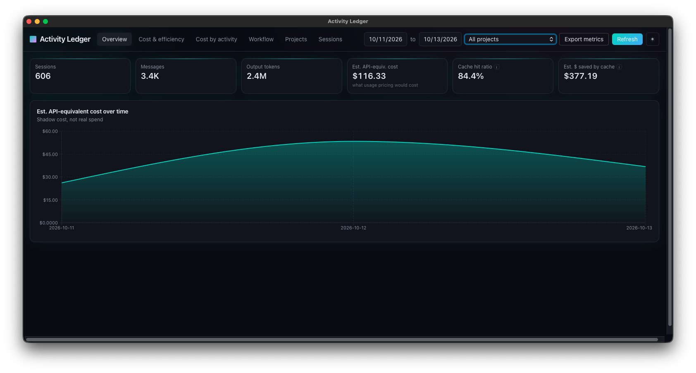
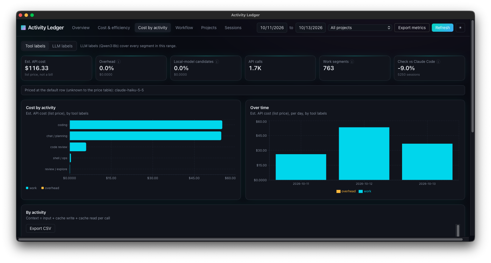
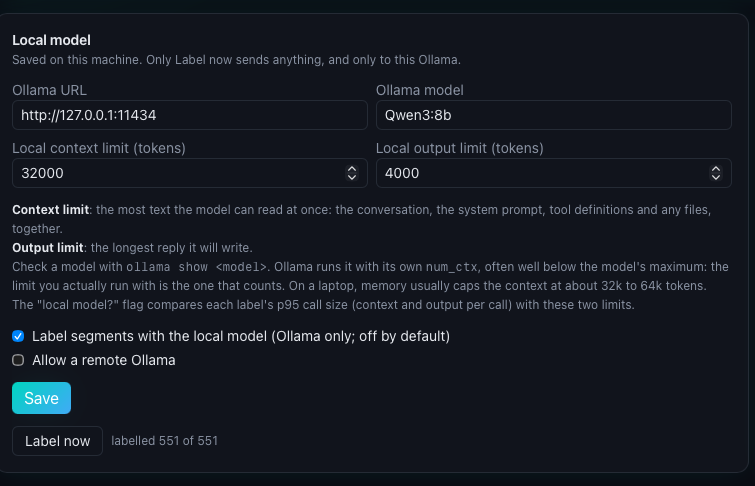

# Activity Ledger

A desktop app that reads your Claude Code transcripts on your own machine and shows where an agent harness spends its tokens: **real work versus overhead**, at API list prices. Inside the work, it shows the kind: coding, debugging, code review, research, and so on.

Activity Ledger is made by Pinkham Software. It is not made, endorsed or supported by Anthropic.

**Everything stays on your machine.** The app reads `~/.claude/projects` and keeps its own cache in the app's data folder on this computer. It makes no network calls, except one optional call to a local model that you run yourself (see [Privacy](#privacy)).

Figures are estimates at Anthropic's published API list prices. They are not an invoice, and they are not your plan's usage.

## Work vs overhead

- Overhead is what keeps the work going but is not the work: context compactions and, with a harness adapter on, its inbox handling, memory upkeep, standups and scheduled jobs.
- A segment a harness starts that goes on to do the work counts as that work, labelled by what it did.
- A harness is one adapter block in `triggers.json`; Munder Difflin is the first, off until you turn it on.

<!-- SCREENSHOT: docs/screenshots/work-vs-overhead.png (Cost by activity with a harness adapter on) goes here. -->



## What it shows

- **Overview:** spend, tokens and sessions over time.
- **Cost and efficiency:** cost per model, cache hit rate, and the price table the estimates use. You can edit the prices.
- **Cost by activity:** every session is cut into segments, one per prompt, and each segment gets a label. Cost, calls and tokens are totalled per label, per day, and split into work and overhead.
- **Workflow, Projects, Sessions:** tool use, cost per project, and a drill down into each session.
- **Export:** a JSON summary with hashed ids and no prompt text, saved to a file you choose.

## How labels work

**Rules first.** Each segment is labelled by fixed rules over what it did, with no model call. The rules look at what started the segment (a prompt you typed, a compaction, a task notification) and at its tool mix: edits, notes, test runs and failing streaks, reads, web lookups, shell commands, and pull request or git range commands. The labels are:

| Label | When |
|---|---|
| coding | it edited or wrote files (code, notes or docs) |
| debugging | it edited or wrote files, and 3 or more test runs failed in a row |
| code review | it read and ran tests, or ran pull request or git range commands, without editing source |
| research | at least 30% of its tools were web lookups |
| review / explore | at least 70% of its tools were reads |
| shell / ops | at least half of its tools were shell commands |
| chat / planning | it used no tools, or only planning tools such as a to-do list or launching a sub-agent |
| other work | none of the above |
| compaction | a context compaction |
| a harness trigger (inbox handling, memory upkeep, standup, scheduled job) | a harness adapter is on, its trigger started the segment, and the segment did only planning or calls on the harness's own files |

**Agent harnesses.** `triggers.json` in the app's data folder lists adapters, one per harness. An adapter names the opening lines that start the harness's upkeep, the senders in its log that mark a standup or a scheduled job, and its bookkeeping files (inbox, memory, board). Calls on those files are bookkeeping, not work. Turn an adapter on or off on the **Agent harness** card; the app then reads the transcripts again. The **By trigger** table shows what started the work and how much of its cost was the work itself.

**An optional local model second.** If you run [Ollama](https://ollama.com), the app can ask your model for a second label for each segment, from a fixed list. The model is given a one-line definition of each label and told to judge mostly by the tool counts. You start this yourself with **Label now**. It is off until you do.

The app asks the model for a JSON answer limited to the label list (Ollama's structured outputs) and turns thinking off, so a thinking model answers instead of reasoning. Use Ollama 0.9 or later: older versions cannot turn thinking off. Checked with llama2, qwen3:8b and gemma4:e2b. The first Label now loads the model, which can take minutes on a Mac without a GPU; the card says "Loading the model" meanwhile.

**A toggle.** On Cost by activity, switch between **Tool labels** and **LLM labels**. The totals are the same in both views. Segments the model has not labelled yet are shown as "not labelled by the model", so nothing is dropped or double counted.



## Privacy

- The app reads Claude Code's transcripts in `~/.claude/projects` on this machine. It never changes them.
- Its cache (a SQLite file in the app's data folder) keeps counts, token totals, costs, timestamps, tool names, labels, model names, the Claude Code version, git branch names, message and tool call ids, the session titles Claude Code wrote, and the project folder and transcript file each record came from. It does not keep your prompts, Claude's replies, tool inputs or commands. Tool inputs are read in memory only to decide a tag such as "test run".
- The only network call is the optional labelling pass, to your Ollama. By default it must be on this machine (a loopback address). A remote host is used only if you tick "Allow a remote Ollama". For each segment it sends tool counts and a short excerpt of the opening prompt. Only the label that comes back is kept.
- The trigger file holds phrases and paths only. With an adapter on, the app reads that harness's log on this machine to pick a label (a standup, a scheduled job) and keeps only the label.
- No telemetry, no accounts, no calls to Anthropic or anyone else.



## Install

There is no signed download yet. Build it from source.

### Requirements

- macOS (the app is developed and tested there; other platforms are untested)
- [Rust](https://rustup.rs) (stable)
- [Node.js](https://nodejs.org) 20 or later
- Xcode Command Line Tools: `xcode-select --install`

### Build

```bash
npm ci
npm run tauri dev       # run in development
npm run tauri build     # build the app for this Mac
```

For one app that runs on both Apple silicon and Intel Macs:

```bash
rustup target add aarch64-apple-darwin x86_64-apple-darwin
npm run build:universal
```

The built app is under `src-tauri/target/.../bundle/macos/`. It is not signed or notarized, so the first time you open it, right click it and choose **Open**.

### Test

```bash
(cd src-tauri && cargo test)
npm run test:ui
npx tsc --noEmit
```

## License

MIT. See [LICENSE](LICENSE). Third-party licenses are in [THIRD_PARTY_NOTICES.md](THIRD_PARTY_NOTICES.md); regenerate that file with `python3 scripts/third_party_notices.py > THIRD_PARTY_NOTICES.md`.

Claude and Claude Code are trademarks of Anthropic. The MIT license covers this code, not those names.

Contact: gary@pinkham-software.com
