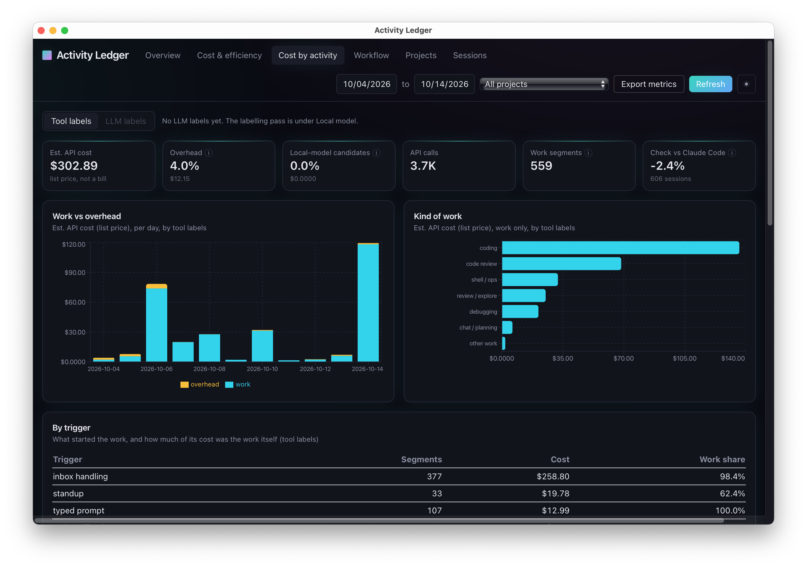
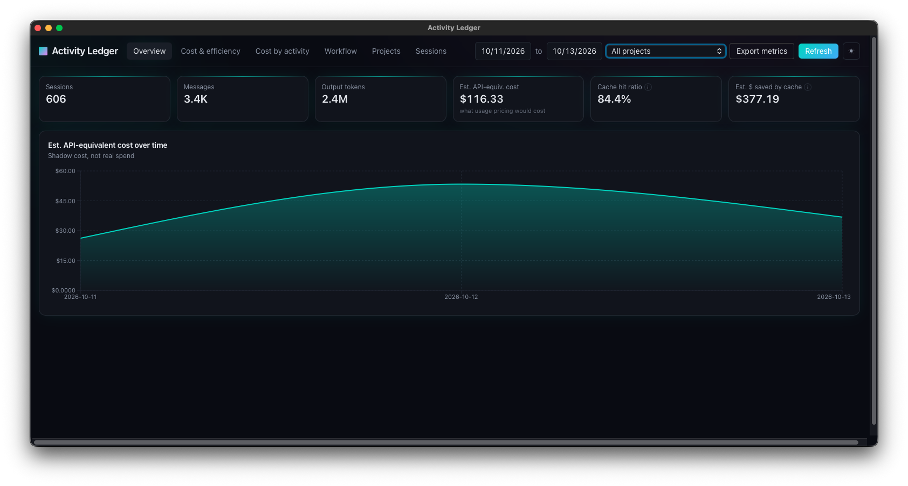
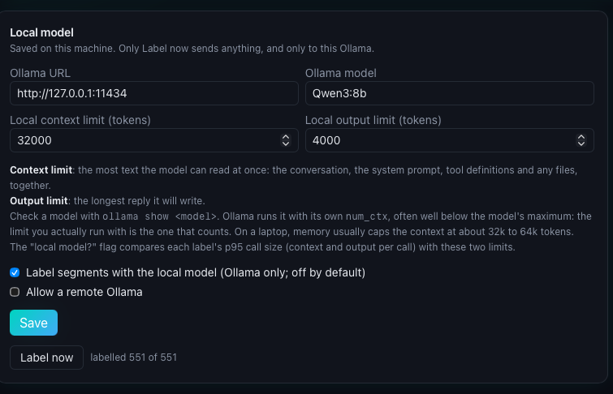

# Activity Ledger

A desktop app that reads your Claude Code transcripts on your own machine and shows where an agent harness spends its tokens: **real work versus overhead**, at API list prices. Inside the work, it shows the kind: coding, debugging, code review, research, and so on.

Activity Ledger is made by Pinkham Software. It is not made, endorsed or supported by Anthropic.

**Everything stays on your machine.** The app reads `~/.claude/projects` and keeps its own cache in the app's data folder on this computer. It makes no network calls, except one optional call to a local model that you run yourself (see [Privacy](#privacy)).

Figures are estimates at Anthropic's published API list prices. They are not an invoice, and they are not your plan's usage.

One row is not from the published list yet. `claude-haiku-5-5` is priced by prompt size: $0.10 input and $0.50 output per million tokens for a prompt of up to 100,000 tokens (input plus cache writes plus cache reads), and $0.50 input and $2.50 output above that. These figures were supplied by the maintainer on 2026-10-15; check them against the provider's pricing page. No cache prices were given, so this model's cache reads and writes use the same multipliers as the other rows (0.1x input for a read, 1.25x or 2x for a write). That part is an assumption. The price editor shows only the lower rate; the rate above 100,000 tokens can be changed only by hand, with the app closed, in `prices.json` in the app's data folder (the file is written the first time you change a price or a pricing option).

## Work vs overhead

- Overhead is what keeps the work going but is not the work: context compactions and, with a harness adapter on, its inbox handling, memory upkeep, standups and scheduled jobs.
- A segment a harness starts that goes on to do the work counts as that work, labelled by what it did.
- A harness is one adapter block in `triggers.json`; Munder Difflin is the first, off until you turn it on.



In this run the overhead share is small: most wake-ups went on to do real work, and standups were the trigger with the most upkeep.



## What it shows

- **Overview:** spend, tokens and sessions over time.
- **Cost and efficiency:** cost per model, cache hit rate, and the price table the estimates use. You can edit the prices.
- **Cost by activity:** every session is cut into segments, one per prompt, and each segment gets a label. Cost, calls and tokens are totalled per label, per day, and split into work and overhead.
- **Workflow, Projects, Sessions:** tool use, cost per project, and a drill down into each session.
- **Weekly report:** one click saves a week (last week, or this week so far) as a Markdown file: totals against the week before, cost by day, model and project, and the five busiest sessions. It is written only when you ask, holds no prompt text, session titles or paths, and can letter projects ("Project A") instead of naming them. The tray's "Save weekly report" opens the same save in the main window.
- **Export:** a JSON summary with hashed ids and no prompt text, saved to a file you choose.
- **Menu bar budget** (optional, off by default): a ring in the menu bar for today's spend against a monthly budget, for anyone working to a company API budget. The budget is spread evenly over the calendar month, so a $300 budget in a 31 day month allows $9.68 a day; days start at local midnight. The ring is green below 80% of today's allowance, amber from 80% and red from 100% (both thresholds can be changed). A click opens today's spend, the month to date, the pace, the projected month end, what is left per day, and today's split between work and overhead. Set it up under Cost by activity, Menu bar budget. With it on, closing the main window keeps the app in the menu bar and out of the Dock.

  The figures are the day view's figures for the same calls, read every 60 seconds from what the transcripts gained since the last read. Both count this Mac's local days. Web searches are priced at $10 per 1,000 here, in the day view and in Cost by activity alike. Every figure is an estimate for this Mac's Claude Code only: not chat, not other machines, and not your invoice. If Claude Code's managed `modelPricing` setting is in `/Library/Application Support/ClaudeCode/managed-settings.json`, its rates are used and the panel says "at configured rates"; otherwise "at list price".

  Clicking the icon while the panel is open hides it on focus loss and the same click may open it again; close it by clicking elsewhere.

## How labels work

**Rules first.** Each segment is labelled by fixed rules over what it did, with no model call. The rules look at what started the segment (a prompt you typed, a compaction, a task notification) and at its tool mix: edits, notes, test runs and failing streaks, reads, web lookups, shell commands, and pull request or git range commands. The labels are:

| Label | When |
|---|---|
| coding | it edited or wrote files (code, notes or docs) |
| debugging | it edited or wrote files, and 3 or more test runs failed in a row |
| code review | it read and ran tests, or ran pull request or git range commands, without editing source |
| research | at least 30% of its tools were web lookups |
| review / explore | at least 70% of its tools were reads |
| shell / ops | at least half of its tools were shell commands |
| chat / planning | it used no tools, or only planning tools such as a to-do list or launching a sub-agent |
| other work | none of the above |
| compaction | a context compaction |
| a harness trigger (inbox handling, memory upkeep, standup, scheduled job) | a harness adapter is on, its trigger started the segment, and the segment did only planning or calls on the harness's own files |

**Agent harnesses.** `triggers.json` in the app's data folder lists adapters, one per harness. An adapter names the opening lines that start the harness's upkeep, the senders in its log that mark a standup or a scheduled job, and its bookkeeping files (inbox, memory, board). Calls on those files are bookkeeping, not work. Turn an adapter on or off on the **Agent harness** card; the app then reads the transcripts again. The **By trigger** table shows what started the work and how much of its cost was the work itself.

**An optional local model second.** If you run [Ollama](https://ollama.com), the app can ask your model for a second label for each segment, from a fixed list. The model is given a one-line definition of each label and told to judge mostly by the tool counts. You start this yourself with **Label now**. It is off until you do.

The app asks the model for a JSON answer limited to the label list (Ollama's structured outputs) and turns thinking off, so a thinking model answers instead of reasoning. Use Ollama 0.9 or later: older versions cannot turn thinking off. Checked with llama2, qwen3:8b and gemma4:e2b. The first Label now loads the model, which can take minutes on a Mac without a GPU; the card says "Loading the model" meanwhile.

**A toggle.** On Cost by activity, switch between **Tool labels** and **LLM labels**. The totals are the same in both views. Segments the model has not labelled yet are shown as "not labelled by the model", so nothing is dropped or double counted.

## Privacy

- The app reads Claude Code's transcripts in `~/.claude/projects` on this machine. It never changes them.
- Its cache (a SQLite file in the app's data folder) keeps counts, token totals, costs, timestamps, tool names, labels, model names, the Claude Code version, git branch names, message and tool call ids, the session titles Claude Code wrote, and the project folder and transcript file each record came from. With a harness adapter on, it also keeps each harness prompt's trigger label and the message ids the prompt named. It does not keep your prompts, Claude's replies, tool inputs or commands. Tool inputs are read in memory only to decide a tag such as "test run".
- The only network call is the optional labelling pass, to your Ollama. By default it must be on this machine (a loopback address). A remote host is used only if you tick "Allow a remote Ollama". For each segment it sends tool counts and a short excerpt of the opening prompt. Only the label that comes back is kept.
- The trigger file holds phrases and paths only. With an adapter on, the app reads that harness's log on this machine to pick a label (a standup, a scheduled job). It keeps the label and the ids of the messages a prompt named, nothing else from the log.
- The menu bar budget reads the same transcripts, and Claude Code's managed settings file for `modelPricing` only. It changes neither.
- No telemetry, no accounts, no calls to Anthropic or anyone else.



## Install

Download the signed app from the [latest release](https://github.com/gpinkham/activity-ledger/releases/latest): one zip that runs on Apple silicon and Intel Macs, signed with a Developer ID and notarized by Apple, so it opens like any other app. Unzip it and move Activity Ledger to Applications. To build it yourself instead, read on. On Windows, see [Windows](#windows).

### Requirements

- macOS or Windows 10/11 (other platforms are untested)
- [Rust](https://rustup.rs) (stable)
- [Node.js](https://nodejs.org) 22 or later
- On macOS: Xcode Command Line Tools: `xcode-select --install`
- On Windows: [Microsoft C++ Build Tools](https://visualstudio.microsoft.com/visual-cpp-build-tools/) ("Desktop development with C++") and WebView2, which Windows 10 and 11 already have

### Build

```bash
npm ci
npm run tauri dev       # run in development
npm run tauri build     # build the app for this computer
```

For one app that runs on both Apple silicon and Intel Macs:

```bash
rustup target add aarch64-apple-darwin x86_64-apple-darwin
npm run build:universal
```

The built app is under `src-tauri/target/.../bundle/macos/`. A build you make yourself is not signed or notarized, so the first time you open it, right click it and choose **Open**. The download from the releases page needs no such step.

### Windows

There is no signed Windows download yet; build it yourself.

**Set up** (once, in PowerShell; the Build Tools take a while and ask for admin):

```powershell
winget install Microsoft.VisualStudio.2022.BuildTools --override "--quiet --wait --norestart --add Microsoft.VisualStudio.Workload.VCTools --includeRecommended"
winget install Rustlang.Rustup
winget install OpenJS.NodeJS.LTS
winget install Git.Git
```

WebView2 is already part of Windows 10 and 11. Keep the repository on a Windows drive (for example `C:\projects\activity-ledger`), not inside WSL: npm and cargo are slow and unreliable over `\\wsl.localhost`.

**Build and run** with the same commands as above. `npm run tauri dev` runs the current code without installing anything. `npm run tauri build` makes an MSI and a setup `.exe` under `src-tauri\target\release\bundle\msi\` and `bundle\nsis\`.

- **Smart App Control** must be off to build: every Rust build runs small programs it compiles itself, and Smart App Control blocks them. It has no per-app exceptions. It also blocks running an unsigned build. Turn it off under Windows Security, App & browser control, Smart App Control.
- **SmartScreen** warns the first time you run the unsigned installer; choose **More info**, then **Run anyway**.
- **Reinstalling the same version** does nothing: the MSI sees the app as already installed. Uninstall it first (Settings, Apps; your data in the app's data folder is kept), or raise the version.

**What is different on Windows:**

- Transcripts are read from `%USERPROFILE%\.claude\projects` and, for Claude Code run inside WSL, from each WSL user's `~/.claude/projects` in each distro (found with `wsl.exe -l -q`; Docker Desktop's distros are skipped). Reading a distro that is not running starts it. Press **Refresh** to read what is new.
- The budget ring sits in the system tray, and its panel opens above the taskbar. Windows 11 puts a new tray icon in the overflow (the **^** next to the clock); drag it out to keep it in view.
- Claude Code's managed `modelPricing` is read from `C:\Program Files\ClaudeCode\managed-settings.json`.
- The main window opens maximized (`src-tauri/tauri.windows.conf.json`).

CI builds and tests macOS and Windows on every pull request and push to `main` (`.github/workflows/build.yml`).

### Signed build (maintainers)

`scripts/sign-notarize.sh` builds the universal app, signs it with a Developer ID and the hardened runtime, has Apple notarize it, staples the ticket and zips it. It runs on the Mac that holds the certificate, uses the identity and the keychain profile by name only, and reads no secret from a file or a variable. The comments at its top list the one-time setup.

### Test

```bash
(cd src-tauri && cargo test)
npm run test:ui
npx tsc --noEmit
```

186 Rust tests and 36 front-end tests; on Windows the 4 tests of the macOS signing script are skipped. The weekly report's expected output is checked in at `src-tauri/tests/fixtures/weekly-report.golden.md`; after a deliberate change, rewrite it with `UPDATE_GOLDEN=1 cargo test report::` and read the diff.

## License

MIT. See [LICENSE](LICENSE). Third-party licenses are in [THIRD_PARTY_NOTICES.md](THIRD_PARTY_NOTICES.md); regenerate that file with `python3 scripts/third_party_notices.py > THIRD_PARTY_NOTICES.md`.

Claude and Claude Code are trademarks of Anthropic. The MIT license covers this code, not those names.

Questions, bugs or ideas: open an issue on this repository.
